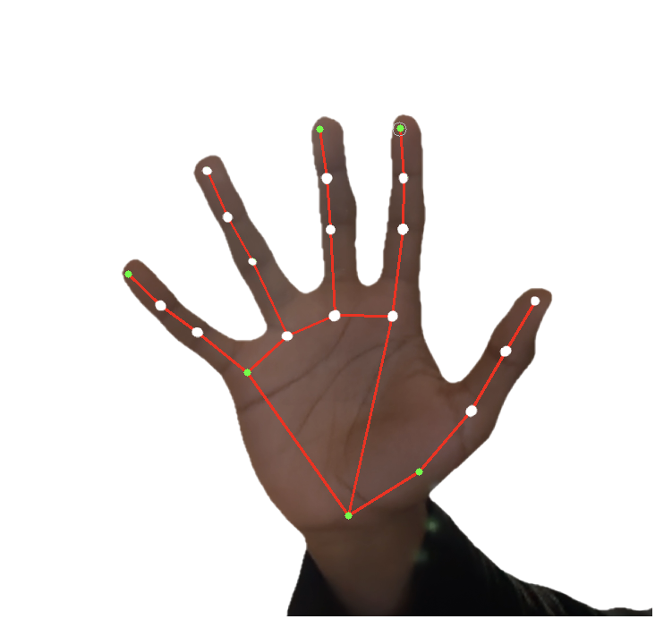

# My First Computer Vision Journey: AirControl

Welcome! This repository documents my very first steps into the field of **Computer Vision**. 

##  Learning & Experimentation

Before diving into building a standalone project, I dedicated time to learning the core fundamentals of computer vision:

*   **Courses & Training:** Completed initial courses to understand essential concepts such as image processing, matrix operations, object detection, and tracking.
*   **OpenCV:** Hands-on experimentation with image filtering, feature extraction, and real-time video stream processing.
*   **Open Model Zoo:** Explored pre-trained models from the Open Model Zoo to run efficient deep learning inference on edge hardware.

---

##  Project: AirControl

After building a foundational understanding, I applied these techniques to create my first major project: **AirControl**.

### Overview
AirControl leverages computer vision techniques to enable touchless control and real-time vision-based interaction.

### Key Highlights
* Integrates **OpenCV** for fast frame processing and user interface overlay.
* Utilizes **Open Model Zoo** models for efficient inference.

---

*Feel free to explore the code and documentation*

